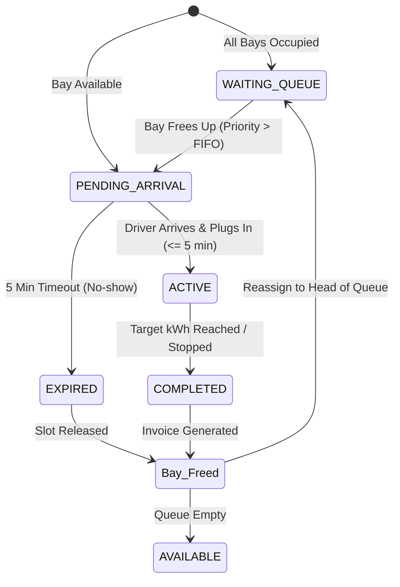

# ⚡ EV ChargeFlow — Deterministic EV Charging Management & Simulation Platform

[](https://opensource.org/licenses/MIT)
[](https://www.oracle.com/java/)
[](https://spring.io/projects/spring-boot)
[](https://github.com/sakshijha786/ev-chargeflow)
[](docs/system_architecture.md)

> **EV ChargeFlow** is a modern, deterministic charging station management platform built for multi-bay EV infrastructure. It features an automated dynamic slot allocation engine, priority-based queuing (Emergency > Premium > Standard) with strict FIFO tie-breaking, a 5-minute arrival grace countdown, automated no-show slot reallocations, statutory rule-based GST billing with client-side PDF invoice generation, and comprehensive operator admin controls.

---

## 🌐 Live Application & Demos

- **Live Web Application**: [https://sakshijha786.github.io/ev-chargeflow/](https://sakshijha786.github.io/ev-chargeflow/)
- **Vercel Mirror**: Accessible via deployed static SPA root.
- **Judge Live Demo Controls**: Look at the persistent top navbar for two instant one-click demonstration triggers:
  1. `⚡ Priority Demo`: Demonstrates emergency medical preemption over a standard waiting queue.
  2. `🔄 Reallocation Demo`: Demonstrates a 20-second no-show timeout and instant automated handoff to the next queued driver.

---

## 🏗️ System Architecture & Constraints

```
               ┌────────────────────────────────────────────────────────┐
               │                 EV ChargeFlow Web SPA                  │
               │   (Deep Navy · Electric Blue · Cyan · SVG Telemetry)   │
               └───────────┬────────────────────────────────┬───────────┘
                           │                                │
            REST Calls / Telemetry API               Static Host
                           ▼                                ▼
               ┌────────────────────────┐       ┌───────────────────────┐
               │    Spring Boot REST    │       │ GitHub Pages / Vercel │
               │   Java 17 / Maven      │       │ Client-Side PDF Gen   │
               └───────────┬────────────┘       └───────────────────────┘
                           │
       ┌───────────────────┼───────────────────┐
       ▼                   ▼                   ▼
┌──────────────┐    ┌──────────────┐    ┌──────────────┐
│  Allocation  │    │   Priority   │    │ Rule-Based   │
│    Engine    │    │ Queue (FIFO) │    │   Billing    │
└──────────────┘    └──────────────┘    └──────────────┘
       │                   │                   │
       └───────────────────┼───────────────────┘
                           ▼
              ┌─────────────────────────┐
              │   Relational Storage    │
              │  (H2 / MySQL / Postgres)│
              └─────────────────────────┘
```

### 🔒 Deterministic Constraint Guarantee
- **100% Rule-Based Scheduling**: Zero AI/ML probabilistic models, zero random heuristics.
- **Privacy First**: Zero external map APIs, zero GPS tracking, zero driver geolocation polling.
- All decisions (allocations, queue shifts, and timeout penalties) are provably reproducible and audit-traceable.

---

## ⚙️ Core Modules & Scheduling Logic

### 1. Dynamic Slot Allocation Engine
- **No Manual Bay Selection**: Incoming charging requests are evaluated automatically without requiring user guesswork.
- **Power Constraint Matching**:
  - High-tier requests (`EMERGENCY` and `PREMIUM`) are dynamically routed to high-speed **DC Fast Chargers** ($60\text{ kW}$).
  - Standard requests (`STANDARD`) are matched to standard DC ($30\text{ kW}$) or AC ($22\text{ kW}$) bays to preserve fast DC capacity for emergency services.

### 2. Automated Deterministic Queue (Priority + FIFO)
- When all bays are occupied, drivers enter a deterministic Priority Queue:
  $$\text{Priority Rank: } \text{EMERGENCY (Rank 3)} > \text{PREMIUM (Rank 2)} > \text{STANDARD (Rank 1)}$$
- **Tie-Breaking Rule**: For identical priorities, rank is decided strictly by FIFO arrival timestamp:
  $$A \prec B \iff \text{Timestamp}(A) < \text{Timestamp}(B)$$
- **Automatic Reallocation**: The exact instant a charger completes, cancels, or expires, the top-ranked driver in the queue is automatically promoted and reserved to that bay.

### 3. Arrival Grace Period & No-Show Expiry
- Reserved drivers receive an arrival countdown (configurable default: 5 minutes / $300\text{ s}$).
- At 2 minutes remaining, an urgent check-in reminder notification is issued.
- If the driver fails to plug in before the deadline, background scheduler (`BookingExpiryScheduler`) marks the booking `EXPIRED`, frees the bay, and instantly hands off the slot to the next queued driver.

### 4. Rule-Based Billing Engine & Taxation
Billing is calculated deterministically with statutory GST:
$$\text{Energy Cost } (\text{INR}) = \text{Delivered kWh} \times 18.00$$
$$\text{Session Fee } (\text{INR}) = 25.00 \quad (\text{if Energy Delivered} > 0)$$
$$\text{Subtotal } (\text{INR}) = \text{Energy Cost} + \text{Session Fee}$$
$$\text{CGST } (9\%) = \text{Subtotal} \times 0.09$$
$$\text{SGST } (9\%) = \text{Subtotal} \times 0.09$$
$$\mathbf{\text{Grand Total } (\text{INR})} = \mathbf{\text{Subtotal} \times 1.18}$$

- **Zero-Dependency PDF Generation**: Drivers and operators can instantly generate, view, and print official Tax Invoices, Monthly Account Statements, and Station Audit Reports directly in the browser as pure vector PDFs.

---

## 📊 State Transition Lifecycle



---

## 🚀 Application Pages & User Experience

Designed with premium SaaS aesthetics (Deep Navy `#0B1220`, Electric Blue `#2563EB`, Cyan `#06B6D4`, Emerald `#22C55E`, Amber `#F59E0B`, Light Slate `#F8FAFC`):

| Page | View | Description |
|---|---|---|
| **Landing Page** | Public | Overview of station features, live bay status preview, pricing formula |
| **Auth** | Public | Instant toggle between Sign In and Register (Driver vs Operator) |
| **User Dashboard** | Driver | Live session status, quick stats, active station bays grid |
| **Request Charging**| Driver | Interactive vehicle selector, SoC battery slider, cost estimator |
| **Queue Status** | Driver | Live position indicator, ETA countdown, queue fairness rules |
| **Active Charging** | Driver | Real-time SVG circular telemetry ring, delivered kWh, running bill |
| **Billing** | Driver | Tax invoices table, download statement as PDF, tariff breakdown |
| **Charging History**| Driver | Historical logs with individual PDF tax invoice downloads |
| **Notifications** | Driver | High-priority arrival reminders, queue promotions, timeout alerts |
| **Admin Dashboard** | Operator| Real-time KPIs, live charging progress, queue overview, daily revenue |
| **Walk-in Customer**| Operator| Register on-site drivers directly into the shared priority queue |
| **Charger Mgmt** | Operator| Monitor bays, toggle operational status (Available / Maintenance) |
| **Queue Mgmt** | Operator| Manually elevate priority, evict queue entries, force-expire no-shows |
| **Revenue Reports** | Operator| 7-day revenue charts, charger utilization, station billing audit PDF |

---

## 📡 REST API Reference

The Spring Boot backend exposes clean REST endpoints wrapped in standard `ApiResponse<T>`:

### Bookings & Allocation
- `POST /api/bookings` — Allocate best available bay or buffer into priority queue
- `POST /api/bookings/walkin` — Register an on-site walk-in customer
- `POST /api/bookings/{id}/arrive` — Confirm arrival at bay, initiate power delivery
- `POST /api/bookings/{id}/complete` — Complete session, calculate bill, reassign bay
- `POST /api/bookings/{id}/cancel` — Cancel booking, release bay to queue
- `GET /api/bookings/{id}` — Fetch single booking details
- `GET /api/bookings` — List all station bookings

### Deterministic Priority Queue
- `GET /api/queue` — Fetch live queue ordered by Priority (Emergency > Premium > Standard), then FIFO
- `POST /api/queue/{id}/promote` — Operator elevates queue entry priority
- `DELETE /api/queue/{id}` — Operator removes entry from queue

### Chargers & Hardware Telemetry
- `GET /api/chargers` — Real-time telemetry of all station bays
- `GET /api/chargers/available` — List currently available chargers
- `GET /api/chargers/{id}` — Specific charger details
- `PATCH /api/chargers/{id}/status` — Toggle operational state (`AVAILABLE`, `OUT_OF_SERVICE`)

### Invoices & Financial Reports
- `GET /api/invoices` — List all completed tax invoices
- `GET /api/invoices/{id}` — Retrieve invoice by ID
- `GET /api/invoices/user/{userId}` — Fetch invoices for specific driver
- `GET /api/invoices/summary` — Aggregate revenue, delivered energy, and GST totals

### Admin & Operations
- `GET /api/admin/metrics` — Station KPI summary (active bays, queue depth, daily revenue)

---

## 💻 Local Setup & Execution Guide

### Prerequisites
- Node.js 18+ (for frontend)
- Java 17+ and Maven (for backend)
- Optional: Docker & Docker Compose

### 1. Running the Frontend (Static SPA)
The frontend has **zero external build steps or dependencies**:
```bash
# Serve directly with any static file server:
npx serve frontend -p 3000

# Or open frontend/index.html directly in any modern browser!
```

### 2. Running the Java Spring Boot Backend
The backend comes pre-configured with an **in-memory H2 profile** for instant local execution:
```bash
cd backend
mvn spring-boot:run
```
The API starts on `http://localhost:8080`. H2 database console is accessible at `http://localhost:8080/h2-console`.

To connect to a live MySQL instance, switch the profile in `application.properties`:
```properties
spring.profiles.active=prod
spring.datasource.url=jdbc:mysql://localhost:3306/ev_charging_db?createDatabaseIfNotExist=true
spring.datasource.username=root
spring.datasource.password=your_password
```

### 3. Running with Docker Compose
To launch both MySQL 8.0 and the Spring Boot API together in isolated containers:
```bash
docker-compose up --build -d
```

---

## 🧪 Interactive Judge Demos Walkthrough

To see the system in action without waiting 5 real minutes, use the persistent header demo buttons:

### Demo 1: Priority Preemption (`⚡ Priority Demo`)
1. Click **`⚡ Priority Demo`** in the top navigation.
2. Two drivers (**Aarav Mehta** at Standard priority and **Dr. Priya** at Emergency priority) are placed in the queue simultaneously while all chargers are busy.
3. At 10 seconds, Bay C-01 ($60\text{ kW}$ DC Fast) finishes charging.
4. **Result**: The rule engine bypasses Aarav (#1) and allocates Bay C-01 immediately to **Dr. Priya** due to emergency priority!
5. When the next bay opens, Aarav is allocated.

### Demo 2: No-Show Reallocation (`🔄 Reallocation Demo`)
1. Click **`🔄 Reallocation Demo`** in the top navigation.
2. All chargers are set to busy. **Rohan**, **Vikram**, **You (Aarav)**, and **Sana** queue up.
3. Bay C-03 opens and is reserved for Vikram with an arrival timer.
4. Vikram fails to arrive within the arrival window.
5. **Result**: At timeout, Vikram's reservation expires. Bay C-03 is instantly reallocated to **You (Aarav)**, and Sana moves up to #1!

---

## 📁 Repository Layout

```
ev-chargeflow/
├── backend/
│   ├── src/main/java/com/evcharging/station/
│   │   ├── controller/      # REST API endpoints (Bookings, Queue, Chargers, Invoices, Admin)
│   │   ├── entity/          # JPA Entities (Booking, Charger, User, WaitingQueueEntry, Invoice)
│   │   ├── enums/           # PriorityLevel, ChargerStatus, BookingStatus, QueueStatus
│   │   ├── repository/      # Spring Data JPA repositories with priority queries
│   │   ├── service/         # Dynamic allocation engine, queue service, billing service
│   │   ├── scheduler/       # Background no-show sweeper and reminder schedulers
│   │   ├── dto/             # Request/response payloads and ApiResponse wrapper
│   │   └── exception/       # GlobalExceptionHandler, Custom REST exceptions
│   ├── src/main/resources/  # application.properties, application-dev.properties
│   ├── Dockerfile           # Multi-stage production container build
│   └── pom.xml              # Maven dependencies (Spring Boot 3.3.4, H2, MySQL, Postgres)
├── frontend/
│   ├── index.html           # Full Single-Page Application with live SVG telemetry & PDF gen
│   ├── package.json         # Deployment package specification
│   └── vercel.json          # Vercel routing and security header configuration
├── docs/
│   └── system_architecture.md # In-depth deterministic logic & scheduling specification
├── .github/workflows/
│   └── deploy.yml           # Automated CI/CD pipeline and GitHub Pages deployment
├── docker-compose.yml       # Production container orchestration (MySQL + Backend)
├── index.html               # Root redirect / preview entry point
├── package.json             # Root workspace metadata
└── README.md                # Comprehensive documentation
```

---

## 📄 License
This project is licensed under the MIT License — see the [LICENSE](LICENSE) file for details.
