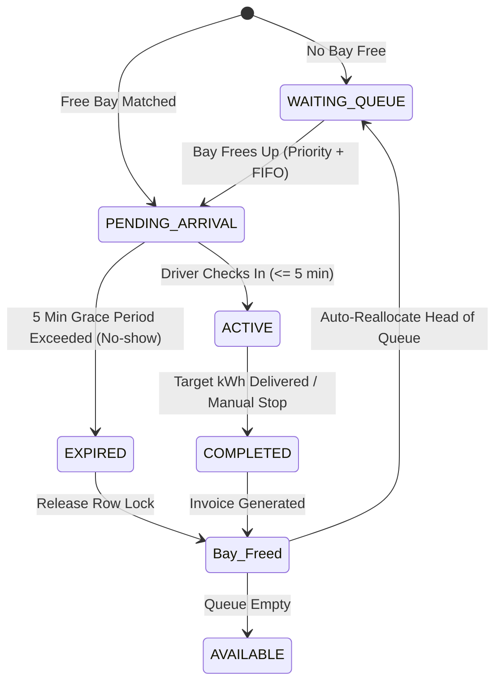

# EV ChargeFlow — System Architecture & Deterministic Logic Specification

## 1. System Overview

**EV ChargeFlow** is a modern, deterministic EV charging management platform engineered for commercial and municipal multi-bay charging hubs. 

### Core Design Philosophy
- **Deterministic Scheduling Only**: Zero probabilistic models, zero AI/ML inference, and zero GPS/location-tracking dependencies. 
- **Strict Rule Engine**: All allocation decisions, queue handoffs, and timeout penalties are 100% deterministic, audit-traceable, and reproducible.
- **Fair Resource Allocation**: Priority preemption (Emergency > Premium > Standard) combined with strict FIFO tie-breaking ensures critical vehicles (e.g. emergency response, ambulances) are serviced immediately while maintaining fairness for standard commuters.

---

## 2. Core Scheduling & Allocation Architecture

### 2.1 State Transition Lifecycle



### 2.2 Priority Queue Logic

When all bays are occupied, incoming requests are buffered in a deterministic Priority Queue:

$$\text{Priority Rank: } \text{EMERGENCY (Rank 3)} > \text{PREMIUM (Rank 2)} > \text{STANDARD (Rank 1)}$$

**Tie-Breaking Rule:**
$$\text{For any two requests } A \text{ and } B \text{ where } \text{Priority}(A) = \text{Priority}(B):$$
$$A \prec B \iff \text{Timestamp}(A) < \text{Timestamp}(B) \quad (\text{Strict FIFO})$$

### 2.3 Dynamic Slot Allocation Engine

Chargers vary by maximum power delivery:
- **DC Fast Chargers** ($60\text{ kW}$): Allocated with highest priority to Emergency and Premium requests.
- **DC Standard Chargers** ($30\text{ kW}$): Allocated to Standard or mid-tier requests.
- **AC Standard Chargers** ($22\text{ kW}$): Allocated to long-dwell or Standard commuters.

When a bay opens, the engine performs power constraint matching:
```
IF headOfQueue.priority >= PREMIUM:
    Allocate highest available kW charger
ELSE:
    Allocate lowest suitable available kW charger to preserve DC Fast bays for emergencies
```

---

## 3. Grace Period & Automated No-Show Reallocation

1. **Reservation Window**: Driver is granted a 5-minute ($300\text{ s}$) arrival window.
2. **Reminder Notification**: If not arrived at $T = 3\text{ min}$ ($120\text{ s}$ remaining), an urgent reminder alert is triggered.
3. **No-Show Expiry**: At $T = 5\text{ min}$, `BookingExpiryScheduler` sweeps the booking:
   - Sets booking state to `EXPIRED`.
   - Dispatches no-show notification.
   - Immediately invokes `releaseChargerAndPromoteQueue(charger)`.
   - Head of the queue is assigned the bay with their own fresh 5-minute arrival countdown.

---

## 4. Rule-Based Billing Engine & Taxation

All session charges strictly follow the standard statutory tariff model:

$$\text{Energy Charge } (\text{INR}) = \text{Delivered kWh} \times 18.00$$
$$\text{Session Booking Fee } (\text{INR}) = \begin{cases} 25.00 & \text{if Delivered kWh} > 0 \\ 0.00 & \text{if No-show/Cancelled} \end{cases}$$
$$\text{Subtotal } (\text{INR}) = \text{Energy Charge} + \text{Session Booking Fee}$$
$$\text{CGST } (9\%) = \text{Subtotal} \times 0.09$$
$$\text{SGST } (9\%) = \text{Subtotal} \times 0.09$$
$$\text{Total GST } (18\%) = \text{CGST} + \text{SGST} = \text{Subtotal} \times 0.18$$
$$\mathbf{\text{Grand Total } (\text{INR})} = \mathbf{\text{Subtotal} + \text{Total GST}} = \mathbf{\text{Subtotal} \times 1.18}$$

---

## 5. REST API Specification

| Endpoint | Method | Description |
|---|---|---|
| `/api/bookings` | `POST` | Allocate best charger or enter priority queue |
| `/api/bookings/walkin` | `POST` | Operator registration for on-site walk-ins |
| `/api/bookings/{id}/arrive` | `POST` | Check-in at bay, begin power delivery |
| `/api/bookings/{id}/complete`| `POST` | End charging, calculate bill, promote queue |
| `/api/bookings/{id}/cancel`  | `POST` | Release bay, promote queue |
| `/api/queue` | `GET` | Retrieve live priority-ordered waiting list |
| `/api/queue/{id}/promote` | `POST` | Operator elevates queue priority |
| `/api/queue/{id}` | `DELETE` | Operator evicts queue entry |
| `/api/chargers` | `GET` | Real-time status of all station chargers |
| `/api/chargers/{id}/status` | `PATCH`| Toggle charger operational state |
| `/api/invoices` | `GET` | Audit list of all completed tax invoices |
| `/api/invoices/summary` | `GET` | Total revenue, energy delivered, GST collected |
| `/api/admin/metrics` | `GET` | Station overview KPI telemetry |
